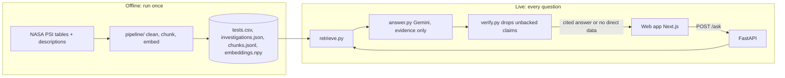
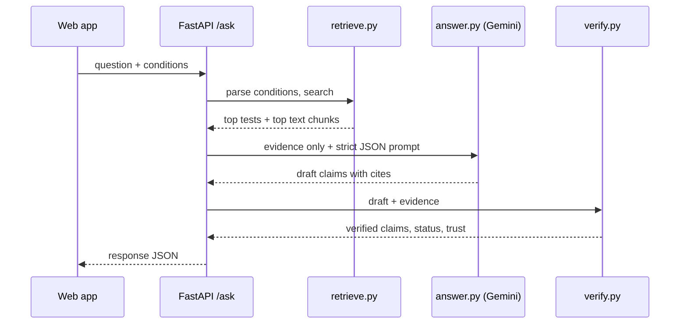

# FlameCheck — Architecture

NASA Space Apps 2026 · Challenge: **Flame in Freefall** · Chicago

FlameCheck is a fire-safety copilot. It answers questions **only** from NASA microgravity combustion experiments (NASA PSI database), cites every claim, and says **"no direct data"** when NASA never tested the conditions asked about.

---

## 1. Goals and non-goals

| Goals | Non-goals |
| --- | --- |
| Answer fire-safety questions with cited NASA evidence | Predict flammability with a new physics model |
| Rank the experiments closest to the user's conditions | Cover rockets or propellants (out of PSI scope) |
| Say "no direct data" honestly (e.g. Moon/Mars gravity) | Store user accounts or history |
| Show what NASA has and hasn't tested (coverage map) | Process raw video or 14 TB of raw PSI data |
| Prove accuracy with a test set | Replace engineering safety reviews |

**Users:** aerospace engineers, researchers, grad students (the challenge's target audience).

**Key fact from the challenge brief:** PSI has **no partial-gravity combustion data**. A Moon base will likely run at **30%+ O₂ and ≤10.2 psi (≈70.3 kPa)**. Microgravity (0 g) and Earth (1 g) results can only *bound* what happens at lunar gravity.

---

## 2. System overview



A rendered copy is in `FlameCheck_Architecture.png`.

**The rule that makes FlameCheck different:** nothing the LLM writes reaches the user until `verify.py` has checked it against the data.

---

## 3. Components

| Component | Folder / file | Job |
| --- | --- | --- |
| Data cleaners | `pipeline/clean_*.py` | Turn raw PSI downloads into one clean table |
| Indexer | `pipeline/build_index.py` | Split text into chunks, make embeddings |
| API | `api/main.py` | HTTP endpoints, CORS, error handling |
| Retriever | `api/retrieve.py` | Find the tests and text closest to the question |
| Answer engine | `api/answer.py` | Ask Gemini for a JSON answer from evidence only |
| Verifier | `api/verify.py` | Check every citation and number; decide "no direct data" |
| Trust scorer | `api/trust.py` | High / Medium / Low badge |
| Web app | `web/` | Ask screen, Explore screen, coverage map |
| Eval harness | `eval/` | 20 test questions, scoring script |

One team, one shared chat: everything above is built in a single track, in phase order.

---

## 4. Tech stack

| Layer | Choice | Why |
| --- | --- | --- |
| Data | Python 3.11, pandas | Fast to clean messy tables |
| API | FastAPI + Pydantic | Typed request/response, auto docs at `/docs` |
| LLM | Gemini (Flash for speed) | $25 Google credits from the event |
| Embeddings | Gemini embeddings, stored in `embeddings.npy` | No vector DB needed for < 5,000 chunks |
| Web | Next.js (App Router) + Tailwind + shadcn/ui | Fast, polished UI |
| Charts | Recharts | Coverage map scatter plot |
| Hosting | Vercel (web), Google Cloud Run or Render (API) | Free tier, quick deploy |

---

## 5. Data model

All clean data lives in `data/clean/`. Raw downloads stay in `data/raw/` (git-ignored).

**Golden rule:** if a value is not in the NASA source, the cell is **empty (null)**. Never guess or fill in.

### 5.1 `tests.csv` — one row per test

| Column | Type | Unit | Example | Notes |
| --- | --- | --- | --- | --- |
| `test_id` | string | — | `BASS2-B1` | Unique. Prefix = investigation |
| `investigation` | string | — | `BASS-II` | |
| `psi_id` | string | — | `PSI-25` | |
| `platform` | string | — | `ISS MSG` | ISS rack, Cygnus, etc. |
| `fuel_phase` | enum | — | `solid` | `solid` / `liquid` / `gas` |
| `material` | string | — | `PMMA` | Fuel or sample name as NASA wrote it |
| `sample_geometry` | string | — | `flat sheet` | Shape and size if given |
| `o2_pct` | float | % | `21.0` | Oxygen concentration |
| `pressure_kpa` | float | kPa | `101.3` | Convert from psi/atm in cleaning |
| `diluent` | string | — | `N2` | N₂, CO₂, He |
| `flow_cm_s` | float | cm/s | `10` | Forced airflow speed |
| `gravity_g` | float | g | `0` | 0 = microgravity, 1 = Earth |
| `outcome` | enum | — | `burned` | `ignited`, `burned`, `extinguished`, `no_ignition`, `other` |
| `spread_rate_mm_s` | float | mm/s | | Only if NASA reports it |
| `extinction_note` | string | — | | Short text if given |
| `source_url` | string | — | PSI page URL | Required |
| `source_file` | string | — | `BASS2_summary.xlsx` | Which raw file the row came from |

Every cleaner also writes its raw-column → schema mapping to `data/clean/MAPPING.md`.

### 5.2 `investigations.json` — one record per investigation

```json
{
  "id": "BASS-II",
  "psi_id": "PSI-25",
  "title": "Burning and Suppression of Solids II",
  "area": ["prevention"],
  "objective": "one or two sentences from the PSI page",
  "hardware": "Microgravity Science Glovebox, SPICE flow duct",
  "fuels": ["solid"],
  "sensors": ["video", "O2/CO2/CO sensors"],
  "test_count": 0,
  "source_url": "PSI page URL"
}
```

`area` is one or more of `prevention`, `detection`, `suppression`.

### 5.3 `chunks.jsonl` — text for the AI to search

One JSON object per line: `chunk_id`, `source_id` (investigation id or NTRS paper id), `title`, `text` (300–500 words), `source_url`.

`embeddings.npy` stores one vector per chunk, in the same order as `chunks.jsonl`.

---

## 6. API contract

Freeze this in Phase 1 so the web app can be built against sample responses (`web/fixtures/*.json`).

### `POST /ask`

**Request**

```json
{
  "question": "Is cotton safe at 34% oxygen on the Moon?",
  "conditions": {
    "material": "cotton",
    "o2_pct": 34,
    "pressure_kpa": 70.3,
    "gravity": "moon",
    "flow_cm_s": null
  }
}
```

`conditions` is optional. `gravity` is one of `micro`, `moon`, `mars`, `earth`.

**Response**

```json
{
  "status": "answered",
  "summary": "Short plain-English answer.",
  "claims": [
    { "text": "One factual sentence.", "cites": ["BASS2-B1"] }
  ],
  "evidence": [
    {
      "test_id": "BASS2-B1",
      "investigation": "BASS-II",
      "match_score": 0.82,
      "o2_pct": 21.0,
      "pressure_kpa": 101.3,
      "gravity_g": 0,
      "outcome": "burned",
      "source_url": "..."
    }
  ],
  "bounds": {
    "microgravity": ["BASS2-B1"],
    "earth": []
  },
  "trust": { "level": "medium", "reason": "2 matching tests, oxygen 13 points lower than asked" },
  "gaps": ["No PSI data at lunar gravity", "No test above 30% O2 for cotton"]
}
```

`status` is one of:

- `answered` — at least one verified claim at matching conditions
- `no_direct_data` — nothing verified matches; `bounds` and `gaps` explain why
- `out_of_scope` — e.g. rockets or propellants

### Other endpoints

| Method | Path | Returns |
| --- | --- | --- |
| GET | `/health` | `{ "ok": true }` |
| GET | `/investigations` | All records from `investigations.json` |
| GET | `/tests?investigation=&material=&o2_min=&o2_max=` | Filtered rows from `tests.csv` |
| GET | `/coverage` | Points for the map: `test_id`, `o2_pct`, `pressure_kpa`, `gravity_g`, `investigation` |

---

## 7. How a question is answered



### 7.1 Retrieval (`retrieve.py`)

Two lanes, merged:

1. **Structured lane (tests).** If the question has no `conditions`, extract them with a small Gemini call (material, O₂, pressure, gravity, flow). Score every row in `tests.csv`:
   - material match (exact or same family) → biggest weight
   - closeness in O₂, pressure, flow → smaller weights, normalized 0–1
   - rows missing a value get no credit for that field (never assumed)
   - keep the top 8 as `evidence`
2. **Text lane (chunks).** Embed the question, cosine-similarity against `embeddings.npy`, keep the top 5 chunks.

Also always return **bounding tests**: the best 0 g matches and best 1 g matches, used when the user asks about Moon or Mars gravity.

### 7.2 Answer (`answer.py`)

- Model: Gemini Flash, temperature 0, JSON output only.
- Input: the question, the evidence rows (as a compact table), the text chunks with ids.
- Prompt rules (keep in `api/prompts/answer.md`):
  - Use only the evidence given. No outside knowledge.
  - Every claim cites at least one `test_id` or `chunk_id`.
  - Copy numbers exactly from evidence; no rounding beyond one decimal.
  - If gravity asked is Moon or Mars, say there is no direct PSI data and describe the 0 g and 1 g bounds.
  - If nothing matches, return no claims.

### 7.3 Verification (`verify.py`) — the core of the project

For each claim:

1. Every id in `cites` must exist in the evidence or chunks sent. Unknown id → drop claim.
2. Every number in the claim text must appear in a cited row or chunk (allow rounding to 1 decimal). Not found → drop claim.
3. A claim about Moon/Mars behavior that cites only 0 g or 1 g data must be phrased as a bound ("at 0 g…", "at 1 g…"). Otherwise → drop claim.

Then decide the status:

- 0 claims left → `no_direct_data` (or `out_of_scope` if the question is about rockets/propellants)
- ≥1 claim left → `answered`

Log every dropped claim and why (`logs/verify.jsonl`). This is great material for the demo and the slides.

### 7.4 Trust score (`trust.py`)

| Level | Rule |
| --- | --- |
| High | 3+ verified tests, same material family, O₂ within 3 points, same gravity |
| Medium | 1–2 verified tests, or conditions near but not matching |
| Low | Only bounding tests (e.g. Moon question), or only text evidence |

Always show the `reason` next to the badge.

---

## 8. Web app (`web/`)

| Screen | Route | Contents |
| --- | --- | --- |
| Ask | `/` | Question box, optional condition fields (material, O₂ %, pressure, gravity), sample questions, AnswerCard |
| Explore | `/explore` | Coverage map + investigation compare table |
| About | `/about` | Data sources, method, test-set score, AI use |

**Components**

- `AnswerCard` — summary, claims with clickable citation chips, status banner
- `TrustBadge` — High / Medium / Low with the reason
- `EvidenceTable` — ranked tests, conditions, outcome, link to PSI
- `GapsList` — what NASA hasn't tested for this question
- `CoverageMap` — scatter: x = pressure (kPa), y = O₂ %, colour = investigation, shaded box = Moon-base zone (O₂ ≥ 30%, pressure ≤ 70.3 kPa)
- `InvestigationCompare` — table of investigations: objective, fuels, hardware, sensors, test count

**Build order:** use `web/fixtures/*.json` (sample `/ask` responses) until the API is live, then switch `NEXT_PUBLIC_API_URL`.

---

## 9. Configuration

| Variable | Where | Example |
| --- | --- | --- |
| `GEMINI_API_KEY` | API only (never the web app) | from Google AI Studio |
| `GEMINI_MODEL` | API | a Gemini Flash model name |
| `ALLOWED_ORIGINS` | API | `http://localhost:3000,https://<your-vercel-app>` |
| `NEXT_PUBLIC_API_URL` | Web | `http://localhost:8000` |

Keep secrets in `.env` (git-ignored). Commit `.env.example` with empty values.

---

## 10. Evaluation (`eval/`)

- `questions.yaml`: 20 questions in 4 kinds — lookup (6), compare (5), suppression (4), no-data (5).
- Each question lists `expected_status`, `must_cite` (test ids), and `must_not_contain` (e.g. invented numbers).
- `run_eval.py` calls `/ask` for each and scores:
  - correct status
  - every citation real
  - required tests cited
  - no numbers outside the evidence
- Output: `eval/results.md` table. Put the totals on a slide and on the About page.

Write expected answers **from the cleaned data**, not from memory.

---

## 11. Key decisions

| Decision | Chosen | Rejected | Why |
| --- | --- | --- | --- |
| Where truth lives | `tests.csv` rows | LLM's knowledge | Judges are NASA experts; every claim must trace back |
| Vector store | `numpy` file | Pinecone, Chroma | < 5,000 chunks; zero setup |
| Answer format | Strict JSON with cites | Free text | Lets `verify.py` check every claim |
| Moon/Mars | "No direct data" + 0 g/1 g bounds | Interpolating a guess | The brief says PSI has no partial-gravity data |
| Scope | 4 priority-1 investigations first | All PSI | Data cleaning is the biggest time risk |

---

## 12. Data sources (confirm each on the PSI site)

| Priority | Investigation | PSI ID | Area |
| --- | --- | --- | --- |
| 1 | BASS-II | PSI-25 | Prevention |
| 1 | Saffire-II | PSI-99 | Prevention |
| 1 | Saffire-III | PSI-100 | Prevention, detection |
| 1 | FLEX | PSI-69 | Suppression |
| 2 | ACME Flame Design | PSI-10 | Prevention |
| 2 | ACME CFI-G (up to 85% O₂) | PSI-159 | High-oxygen |
| 2 | SAME-R | PSI-101 | Detection |
| 3 | Saffire-I, FLEX-2, SLICE | PSI-98, PSI-68, PSI-106 | Extra |

PSI IDs were taken from other teams' public repos; check each one before use.

Text sources: each investigation's PSI description page, plus NASA papers found with the NTRS search API (ntrs.nasa.gov).

---

## 13. Submission requirements (from the Space Apps guide)

- Public final-project link (GitHub repo or site), no login.
- Demo: video ≤ 30 seconds with English subtitles, **or** ≤ 7 slides.
- Fields: summary, description, NASA data used, other data, **AI use** (we use Claude Code and Gemini — disclose both).
- No NASA logos. AI-made images or video need a visible watermark.
